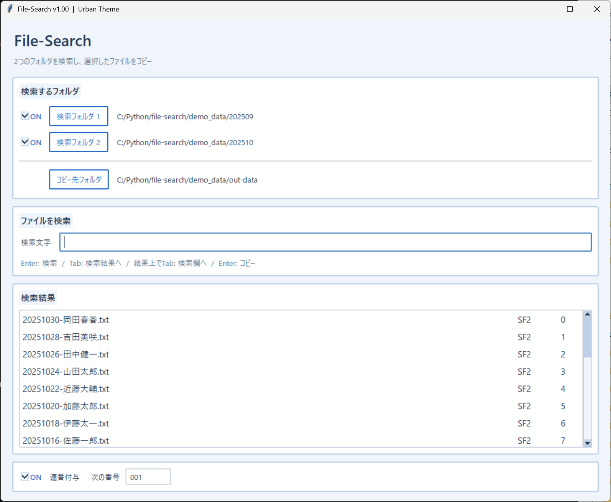

# File-Search — 漢字を組み合わせて氏名ファイルを探す

**氏名を正確に漢字変換できなくても、変換しやすい言葉を手掛かりに検索できる**、Python製のファイル検索・コピー支援ツールです。
検索語は文章にする必要がありません。思いついた短い単語や、送り仮名のある言葉を続けて入力できます。

### 例えば「吉田美咲」を探すなら

検索欄に **`吉田美しい咲く`** と入力します。

| 入力した言葉 | 検索に利用できる漢字 |
| --- | --- |
| 吉田 | 吉・田 |
| 美しい | 美 |
| 咲く | 咲 |

**「吉田美咲」の4文字すべてが一致**するため、該当ファイルが上位に表示されます。漢字が検索欄の中で隣り合っている必要はなく、同じ順番で並ぶ必要もありません。

付属の30件のデモデータでは、実際に次のようになります。

| 一致文字数 | 検索結果の例 |
| --- | --- |
| **4文字** | `20251028-吉田美咲.txt` |
| 3文字 | `20250927-田中美咲.txt` |
| 2文字 | `20250929-吉田花子.txt` |

検索結果は**一致文字数が多い順**に並び、**背景の青色の濃淡**でも違いが分かります。

> このツールは読みや意味を推測する検索ではありません。入力した文字がファイル名のどこかに存在するかを、1文字ずつ数えて比較します。ポイントは、入力時に難しい氏名の漢字を直接変換しなくてもよいことです。

GUIは **GUI Design Studio** で作成したUrban配色＋アウトライン形状を適用しています（Python標準ライブラリのTkinter／ttk）。



*画面見本はWindows実機で取得したものです。環境により細部の表示が異なる場合があります。*

## 操作説明書

- [操作ガイド（GitHubでも読めるMarkdown版）](docs/操作ガイド.md)
- `使い方.html`：ZIPを展開した後、ブラウザで開くオフライン用の説明書です。

※ GitHub上で `.html` を直接クリックすると、ブラウザ表示ではなくソースコード表示になることがあります。GitHubでは上記Markdown版を参照してください。

## 主な機能

- 2つのフォルダのファイル名をまとめて検索。フォルダごとにON/OFF切り替え可能。
- 検索欄に入力した文字が、ファイル名の離れた位置にあっても一致文字数で候補を順位付け。結果の淡い青色が一致度に応じて変化。
- 検索欄で **Enter** すると検索、**Tab** で結果一覧の先頭行へ移動。**↑↓** で選択、結果側の **Tab** で検索欄へ戻ります。
- 結果一覧で **Enter** を押すと、選択したファイルをコピー。コピー成功後は検索欄に戻ります。
- コピー時に `001_` などの連番を付与可能。次の番号も画面下部で変更できます。
- 検索フォルダ1・2、コピー先フォルダをメイン画面の参照ボタンから設定し、従来形式の `file-search.cfg` に自動保存。
- **同名ファイルがある場合は上書き前に確認**。既定は「いいえ」で、キャンセルした場合は連番を消費しません。
- GUI Design Studioから出力した `design_theme.py` / `design_theme.json` を利用（標準ttk限定）。

## インストールと起動

Python 3.10以上の環境を想定しています（`match`文および型注釈を使用）。追加ライブラリは不要です。

```text
file-search/
  file-search.py        本体
  design_theme.py       テーマ適用コード
  design_theme.json     出力したテーマ設定
  docs/                 画面見本（Windows実機）・操作ガイド
  tests/                自動テスト
  demo_data/            架空氏名の検索デモ（各月15件）
  file-search.cfg       実行時に使用する設定（GitHubに登録しない）
```

Windowsの実行例：

```powershell
cd C:\Python\file-search
python .\file-search.py
```

初回はコピー先フォルダを選択し、検索フォルダ1・2を登録してONにしてください。

**既存版から更新する場合**は、必ず `file-search.py` と `file-search.cfg` をバックアップし、`file-search.cfg` を上書きしないでください。必要に応じて `design_theme.py` と `design_theme.json` も同じフォルダに配置します。

## ほかの検索例

| 検索欄への入力 | 探したい氏名 | 一致文字数 |
| --- | --- | ---: |
| `吉田美しい咲く` | 吉田美咲 | 4 |
| `我慢妻功績` | 我妻功 | 3 |
| `小鳥遊ぶ透ける` | 小鳥遊透 | 4 |
| `烏龍丸太毅然` | 烏丸毅 | 3 |

入力するのは短い語句の組み合わせであり、長い文章を考える必要はありません。**ファイル名に含まれる漢字のうち、思い出せるものだけでも検索できます。** 候補が多ければ別の漢字を追加して絞り込めます。

`藤田太郎` のように共通する漢字が多い検索語では、一致文字数の異なる候補が複数出るため、順位と背景色の変化を確認できます。

### 付属デモデータで試す

`demo_data/202509` と `demo_data/202510` に、架空の氏名を使ったテキストファイルを各15件収録しています。検索フォルダ1・2にそれぞれ指定し、ONにして試してください。`demo_data/検索例一覧.csv` には検索語と照合結果をまとめています。コピー先にはデモ用の空フォルダを指定してください。

## コピー時の安全対策

- 同名ファイルがコピー先にあるときは、**そのファイル名を表示して上書き確認**します。「いいえ」はコピーを中止します。
- コピー元とコピー先が同一ファイルの場合、コピーを中止します。
- コピー先に同名フォルダがある場合、コピーを中止します。
- 連番はコピーが成功したときだけ進めます。
- `file-search.cfg` は保存時に初回バックアップ（`.bak`）を作成し、一時ファイルから置換します。

**注意：** 誤ったコピー先の指定・ファイルの内容・上書き許可後の変更については、使用者自身でも確認してください。GitHubに実際の顧客情報や業務用パスを含む `.cfg` を公開しないでください。

## テスト

```powershell
python -m unittest discover -s tests -v
```

LinuxでGUIテストを実行する場合は、`xvfb-run -a python -m unittest discover -s tests -v` を使用してください。テストは一時ディレクトリでダミーファイルを作成して行います。

## 開発について

元の業務用ツールを土台に、Tkinter／ttkのGUIを改修しました。テーマ部分には**GUI Design Studioで出力した設定とPythonコード**を使用しています。実装・改善・検証では生成AIを開発支援として活用しています。AIが生成した変更についてもテストと実機確認を行う方針です。
