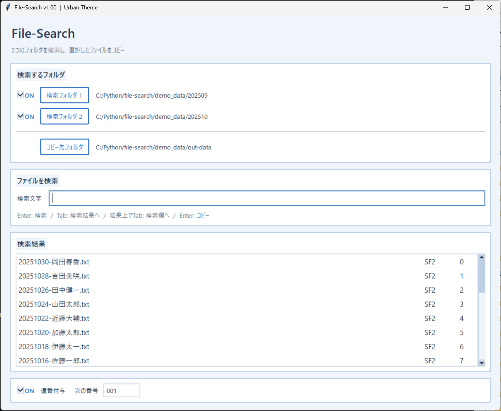

# File-Search 操作ガイド

## 1. このツールの特徴：氏名の漢字を直接変換しなくても探せる

例えば、探したい名前が **「吉田美咲」** なら、検索欄に **`吉田美しい咲く`** と入力します。

- `吉田` から **吉・田**
- `美しい` から **美**
- `咲く` から **咲**

**合計4文字一致**するため、`20251028-吉田美咲.txt` が検索候補の上位に表示されます。文を作る必要はありません。変換しやすい短い言葉をそのまま続けて入力するだけです。

付属の30件のデモデータでの結果例：

| 一致文字数 | ファイル名 |
| --- | --- |
| **4文字** | `20251028-吉田美咲.txt` |
| 3文字 | `20250927-田中美咲.txt` |
| 2文字 | `20250929-吉田花子.txt` |

**文字の並び順・連続性は不要**で、ファイル名のどこかに文字があれば一致数に加えます。一致数の高い候補を上から表示し、背景の青色でも違いを示します。単語の意味や漢字の読みを理解して検索する機能ではありません。

ほかの例：

| 入力する短い語句 | 目的の氏名 | 一致文字数 |
| --- | --- | ---: |
| `我慢妻功績` | 我妻功 | 3 |
| `小鳥遊ぶ透ける` | 小鳥遊透 | 4 |
| `烏龍丸太毅然` | 烏丸毅 | 3 |

## 2. 起動・フォルダ指定

`file-search.py`、`design_theme.py`、`design_theme.json` を同じフォルダに配置し、Python 3.10以上で `python file-search.py` を実行します。検索フォルダ1・2の参照ボタンで検索先を指定し、ON/OFFを設定します。コピー先フォルダも参照ボタンから指定できます。変更は `file-search.cfg` に自動保存されます。

## 3. 検索操作とコピー

- 検索欄：**Enter** で検索、**Tab** で結果一覧の先頭へ移動
- 結果一覧：**↑↓** で選択、**Tab** で検索欄へ戻る、**Enter** でコピー
- 連番付与をONにすると `001_` などの番号を付けます。「次の番号」は画面下部で変更できます。

同名ファイルがコピー先にある場合は確認ダイアログが表示されます。「いいえ」を選ぶとコピーを中止し、連番は進みません。操作前にコピー先を確認してください。

## 4. デモデータ

`demo_data/202509`、`demo_data/202510` に各15件の架空氏名データを収録しています。上記例のほか、`藤田太郎` を検索すると1〜4文字一致の結果が複数並ぶため、順位と色分けのデモに適しています。`demo_data/検索例一覧.csv` に短い検索語をまとめています。

## 5. 詳細版

ZIPを展開して、ルートの `使い方.html` をブラウザで開くと、画面例付きの説明を閲覧できます。GitHub上ではHTMLがソース表示される場合があるため、このMarkdown版も用意しています。
